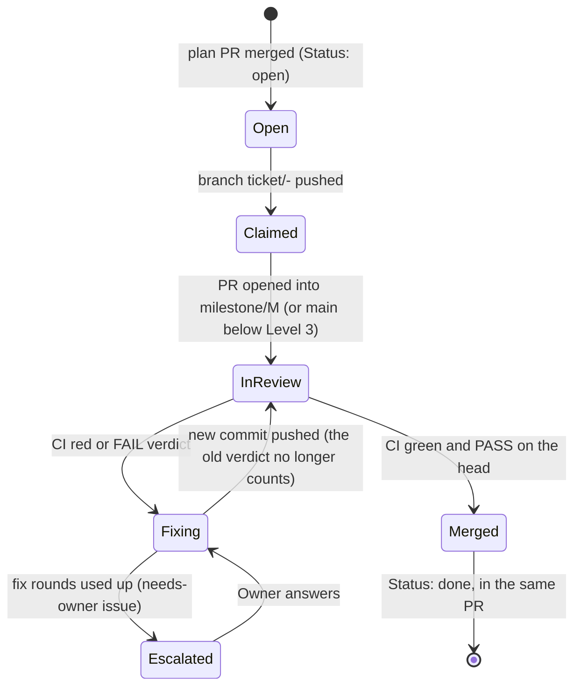
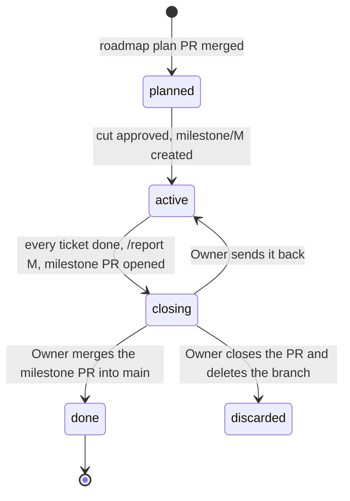
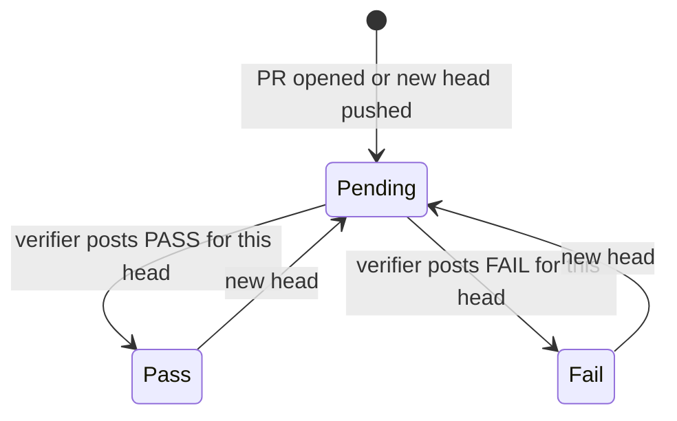
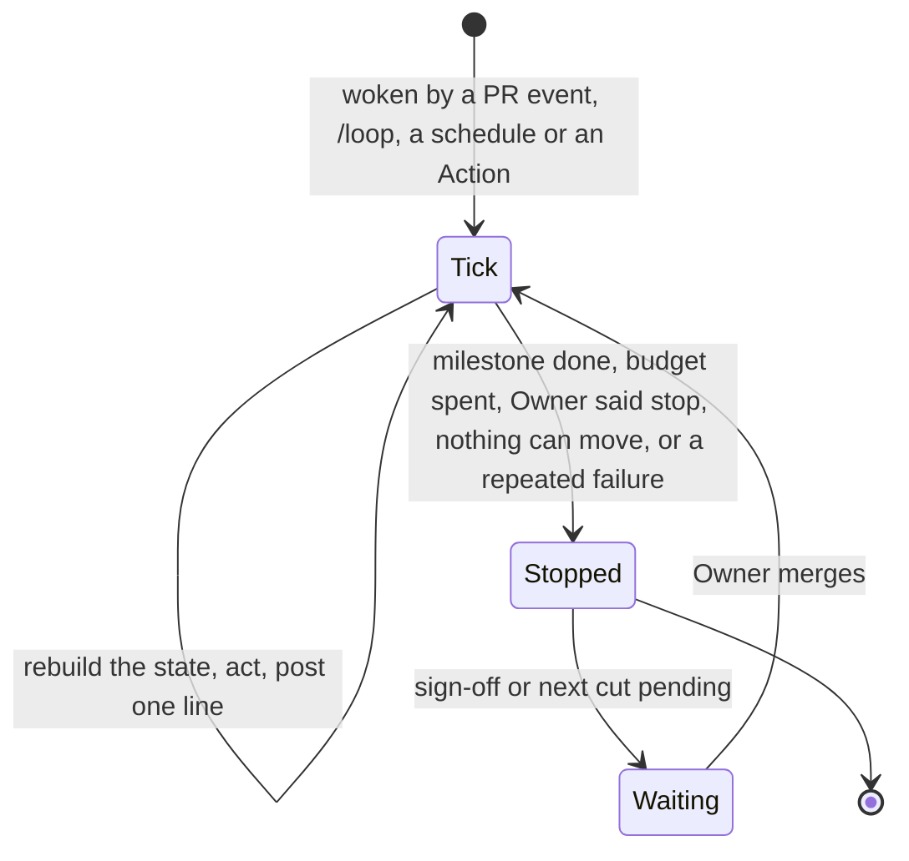

# States: what moves where, and where it is stored

pitaya keeps no state of its own. Every state below lives in the repository or on GitHub, so any fresh session can rebuild it: `/autopilot` does that on every tick, and `/help` does it to say what comes next. If a state isn't in one of the places in [Where state lives](#where-state-lives), it doesn't exist.

## Ticket

A ticket is blocked, not claimable, while any ticket in its "Depends on" isn't done.

## Milestone

Below Level 3 there is no milestone branch: tickets merge into `main`, and the milestone is done when its plan PR sets `Status: done`. At Level 4 the Chief approves the cut inside the milestone branch, and the Owner reviews it at the sign-off.

## PR verdict

Any FAIL on the head is final for that head, and an edited verdict comment is ignored. Plan and milestone PRs never get a passing verdict: the Owner merges them.

## Autopilot run

## Where state lives

| State | Stored in | Changed by |
| --- | --- | --- |
| Ticket open or done | its `Status:` line, on `milestone/M<n>` from Level 3 and on `main` below; or whether its issue is closed | plan PR (open); the ticket's own PR (done) |
| Ticket claimed | a remote branch `ticket/<id>-<slug>`, or an open PR from one | builder or `/autopilot` |
| In review, fixing | the PR's state, its CI and its head commit | builder (pushes), CI |
| Verdict | a verdict comment or review on the PR, for one head commit | verifier |
| Fix rounds used | the number of FAIL verdicts on the PR | verifier |
| Escalated | an open `needs-owner` issue linked from the PR or ticket | any role (`ask-owner`); the Owner closes it |
| Milestone phase | `Status:` in `docs/milestones/M<n>.md`, plus the `milestone/M<n>` branch and its PR | plan PR; the Owner's merge |
| Autopilot progress, stop requests | the tracking issue `Autopilot: M<n>` | `/autopilot`; the Owner comments "stop" |
| Decisions | `docs/decisions.md`, `docs/adr/` | Owner, Chief |
| Handover of stopped work | `docs/handoff/<branch>.md` | `/handoff` |

## Who may move what

- The **Owner** alone moves a milestone to `done` (merging into `main`), approves the roadmap, answers escalations and, below Level 4, approves each cut.
- The **Chief** moves tickets from open to claimed, starts builders and verifiers, and, at Level 3, merges a PR whose head has a PASS and green checks.
- A **Builder** moves its own ticket from claimed to in review and back, and marks it done in its PR.
- A **Verifier** moves a head from pending to pass or fail, and nothing else.
