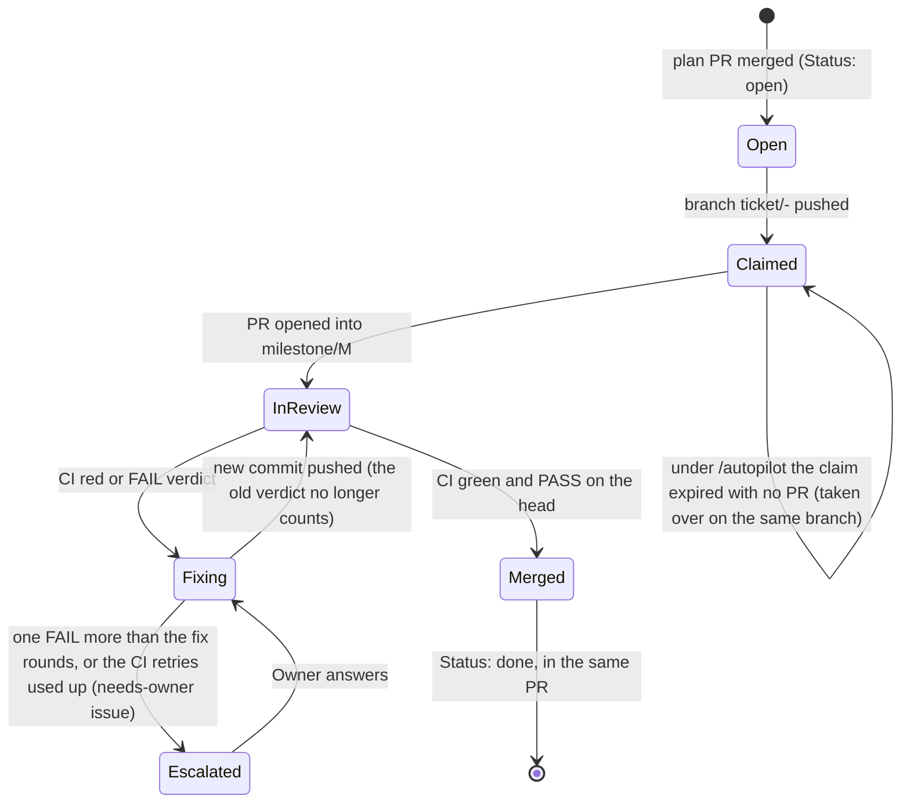
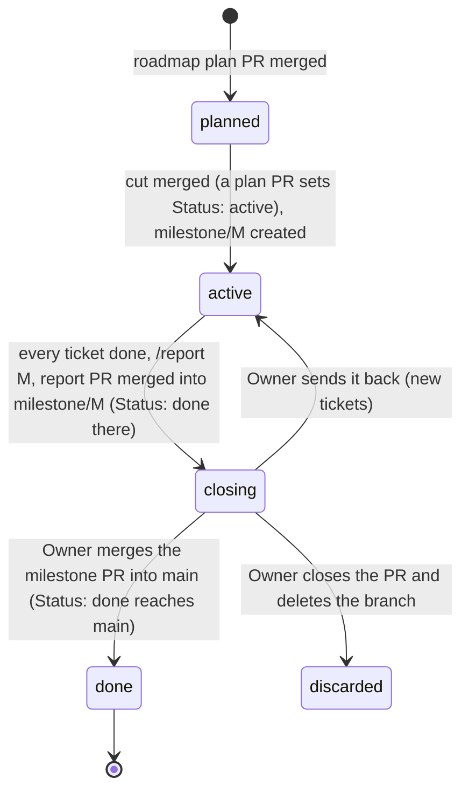
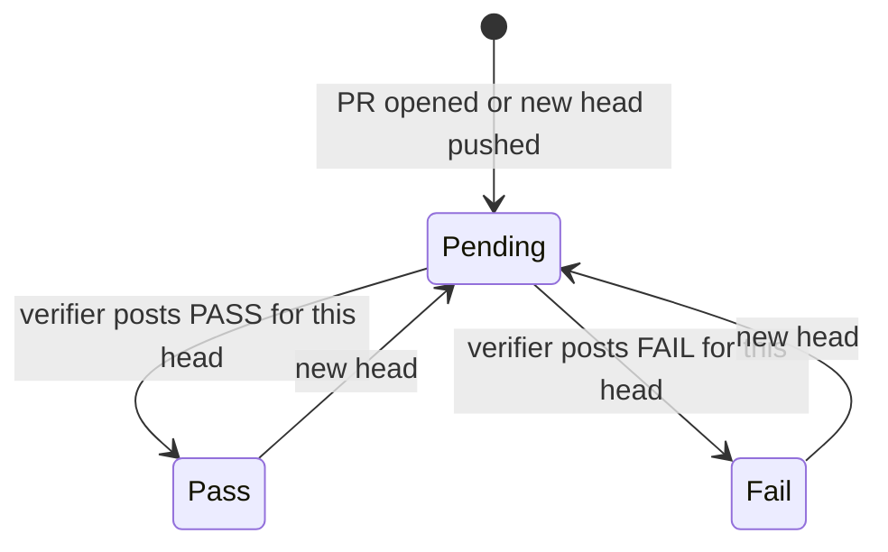

# States: what moves where, and where it is stored

pitaya keeps no state of its own. Every state below lives in the repository or on GitHub, so any fresh session can rebuild it: `/autopilot` does that on every tick, and `/help` does it to say what comes next. If a state isn't in one of the places in [Where state lives](#where-state-lives), it doesn't exist.

## Ticket

A ticket is blocked, not claimable, while any ticket in its "Depends on" isn't done. Its PR targets the milestone's branch at every level; only a ticket that names no milestone targets `main`.

## Milestone

At every level, an active milestone has its branch `milestone/M<n>` (D44): tickets merge into it, and only the milestone PR merges into `main`. What changes with the level is who merges the tickets: the Owner below Level 3, agents from Level 3. At Level 4 the Chief approves the cut inside the milestone branch, and the Owner reviews it at the sign-off.

A milestone's phase is its `Status:` line in `docs/milestones/M<n>.md`, and where it is read decides what it means. Read it on `milestone/M<n>` when that branch exists and on `main` when it doesn't; `Status: done` on `main` settles it whatever the branch says:

- **planned**: `Status: planned`, and no branch yet.
- **active**: `Status: active`. Below Level 4 the cut merged into `main` and the branch starts from there. At Level 4 the cut merged into the branch, so `main` still shows `planned`: a reader that looks only at `main` finds no active milestone and no tickets.
- **closing**: `Status: done` on `milestone/M<n>` and not on `main`. The milestone's report PR (`plan/M<n>-report` into `milestone/M<n>`) set it, together with `docs/reports/M<n>.md`; the milestone PR is open or about to be. That holds while every ticket is done: if the Owner sends it back, it is active again while any new ticket is open, whatever the line says.
- **done**: `Status: done` on `main`. Only the Owner's merge of the milestone PR puts it there, so the sign-off and the status change are one event, and no plan PR follows to complete it.

## PR verdict

A verdict is a comment that starts with the verdict heading and names the full head commit (a PASS also names the verifier's session), or a review from a separate verifier account. A FAIL is one-way: any FAIL on the head is final for that head, and it still counts when its comment is edited or deleted afterwards, because the `agent-merge` workflow records each FAIL it sees in a `verdict-fail` status on the commit. An edited PASS doesn't count, and neither does a PASS from a session the pull request names as a builder. A verifier never pushes to the pull request's branch, so posting a verdict can't move the head it names; its screenshots go to an `evidence/<PR>-<short sha>` branch. At Level 3 a PASS carries over a merge of the base and nothing else, unless the ticket is `Risk: high`. A milestone PR and a plan PR into `main` never get a green `verdict` status: the Owner merges them. A plan PR into a milestone branch gets one without a verifier in two cases, which the check proves from the diff: the milestone's report PR, and at Level 4 a cut ([agent-merge](../guardrails/agent-merge.md)).

## Fix rounds

This is the one definition; every skill points here. A pull request's **round** is the number of FAIL verdicts on it: the verdict comments that say FAIL, plus any commit of the pull request with a `verdict-fail` status and no FAIL comment left. A verify round checks and posts a verdict, a fix round changes code, and they alternate: verify 1, fix 1, verify 2, and so on. `Fix rounds` is the harness file's field (default 2).

| Event | What follows |
| --- | --- |
| FAIL number 1 to `Fix rounds` | The fix round with the same number, then a new verify round |
| FAIL number `Fix rounds` + 1 | Escalate to the Owner (by default the third FAIL). No fix round follows unless the Owner authorises an extra one ([escalation](escalation.md#fix-rounds)) |
| Where a fix round runs | Under `/autopilot`: every round in a fresh session, because a tick can't reach the builder's session. When a person runs the work: round 1 may stay in the builder's session, and every later round is a fresh session |
| Red CI | Not a FAIL, and not a new round: it belongs to the same round as the push that turned it red (round 0 is the first build). A builder that is still at work fixes and pushes until it is green. Under `/autopilot`, a red CI with no builder at work gets a CI retry: a fresh builder session, recorded by an `Autopilot: CI retry <k>` comment on the pull request. After 2 CI retries in one round (the harness file's "Autopilot" line may set another number), the next red CI makes the tick escalate to the Owner instead. One red check is a wait, not a failure: `serial-resources` on the later of two PRs that claim one resource. It gets no CI retry; when the earlier PR merges, "Update branch" runs the check again |

## Autopilot run

```mermaid
stateDiagram-v2
  [*] --> Tick: a person starts the run (Run started); later woken by a PR event, /loop, a schedule or an Action
  Tick --> Tick: rebuild the state, act, post one line
  Tick --> Waiting: the milestone PR, or below Level 4 the next cut's plan PR, waits for the Owner's merge (Waiting line, the wake-up stays)
  Waiting --> Tick: Owner merges (Run started again)
  Tick --> Stopped: budget spent, Owner said stop, nothing can move, a repeated failure, or no milestone left (the wake-up is cancelled)
  Stopped --> [*]
```

## Where state lives

| State | Stored in | Changed by |
| --- | --- | --- |
| Ticket open or done | its `Status:` line on `milestone/M<n>` (on `main` for a ticket outside any milestone); or whether its issue is closed | plan PR (open); the ticket's own PR (done) |
| Ticket claimed | a remote branch `ticket/<id>-<slug>`, or an open PR from one. Under `/autopilot` the claim's time is the tracking-issue line that lists the branch under `Started:`, and a claim with no PR expires (default 2 hours): the next tick takes it over on the same branch | builder or `/autopilot` |
| Session at work | the machine account's start lines, timed by GitHub's `created_at`: an `Autopilot: ... started for <head>` comment on the PR (verifier, fix round, CI retry), or `Started:` on the tracking issue (first build, report, cut). The `autopilot` skill's `tick.md`, "Sessions at work" | `/autopilot` |
| In review, fixing | the PR's state, its CI and its head commit | builder (pushes), CI |
| Verdict | a verdict comment or review on the PR, for one head commit; with agent-merge, also the `verdict` and `verdict-fail` statuses on that commit | verifier; the `agent-merge` workflow |
| Fix rounds used | the number of FAIL verdicts on the PR ([Fix rounds](#fix-rounds)); with agent-merge, a FAIL whose comment was deleted still shows as the `verdict-fail` status on its commit | verifier; the `agent-merge` workflow |
| CI retries used | the machine account's `Autopilot: CI retry <k>` comments on the PR since its latest FAIL verdict | `/autopilot` |
| Escalated | an open `needs-owner` issue linked from the PR or ticket | any role (`ask-owner`); the Owner closes it |
| Milestone phase | `Status:` in `docs/milestones/M<n>.md`, read on `milestone/M<n>` when that branch exists and on `main` when it doesn't ([Milestone](#milestone)), plus the branch's PR | a plan PR (active: into `main`, or at Level 4 into the branch); the first `/build` or `/autopilot` tick creates a missing branch; the report PR (done, on the branch); the Owner's merge of the milestone PR (done, on `main`) |
| Milestone behind `main` | `main` isn't an ancestor of `milestone/M<n>` (a `plan/<slug>` PR merged since); an open PR from `sync/<slug>` brings it in | whoever starts the next ticket, or `/autopilot`, opens the sync PR; it merges like a ticket PR |
| Autopilot progress, stop requests, the run and its budget | the tracking issue `Autopilot: M<n>`: one line per tick, and a run from a `Run started` line to the next `Stopped:` or `Waiting:` (the machine account's lines only). The budget counts from the open run's `Run started` (hours since, ticket PRs merged since), so a wait for the Owner's merge spends none of it | `/autopilot`; a person starts a run, and a wake-up continues one or starts the next after the Owner merged the PR a `Waiting:` line names; the Owner comments "stop" (only the Owner's own comment counts: [escalation](escalation.md#who-can-answer)) |
| Decisions | `docs/decisions.md`, `docs/adr/` | Owner, Chief |
| Handover of stopped work | `docs/handoff/<branch>.md` | `/handoff` |

## Who may move what

- The **Owner** alone moves a milestone to `done` (merging into `main`), approves the roadmap, answers escalations and, below Level 4, approves each cut.
- The **Chief** moves tickets from open to claimed, starts builders and verifiers, and, at Level 3, merges a PR whose head has a PASS and green checks, sync PRs and the milestone's report PR. At Level 4 it also merges the next cut into its milestone branch.
- A **Builder** moves its own ticket from claimed to in review and back, and marks it done in its PR.
- A **Verifier** moves a head from pending to pass or fail, and nothing else.
