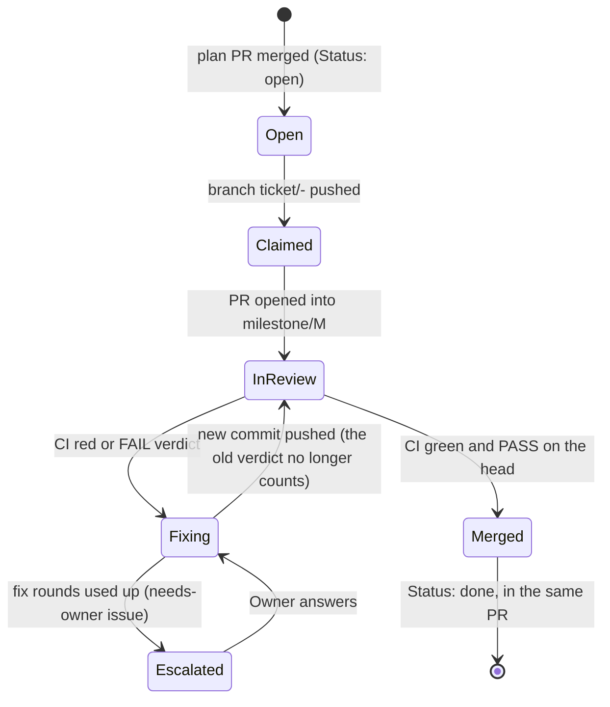
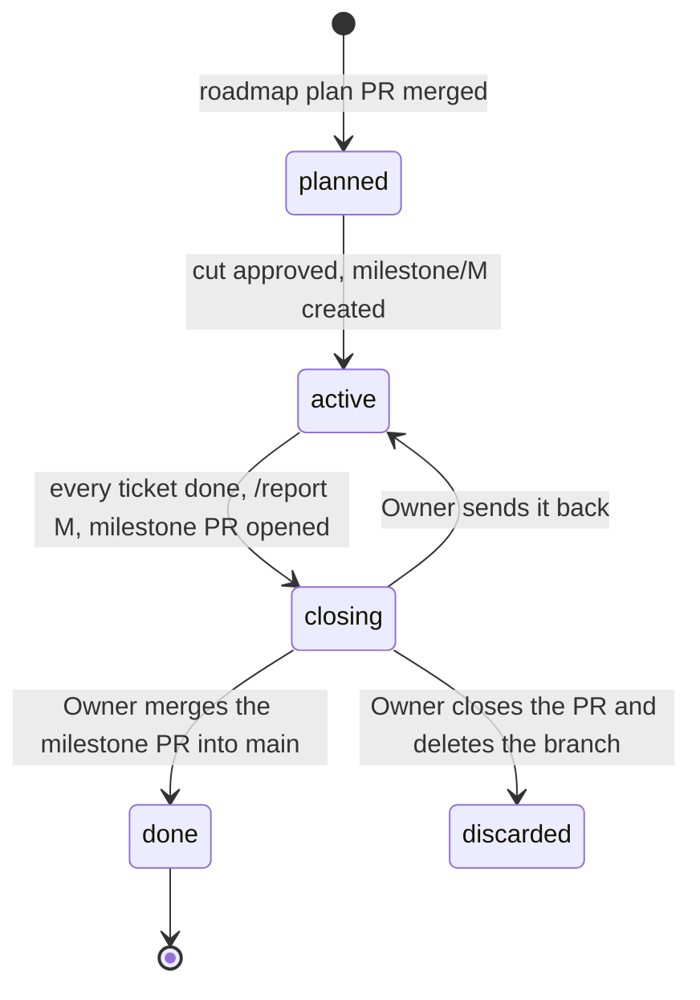
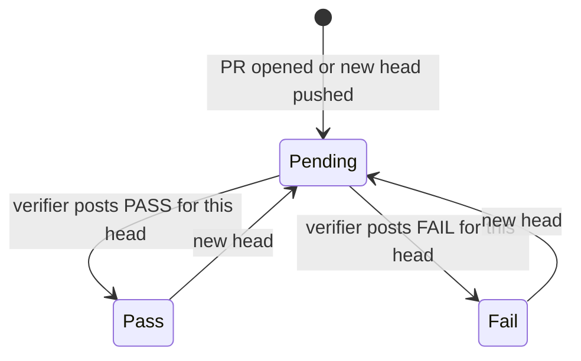
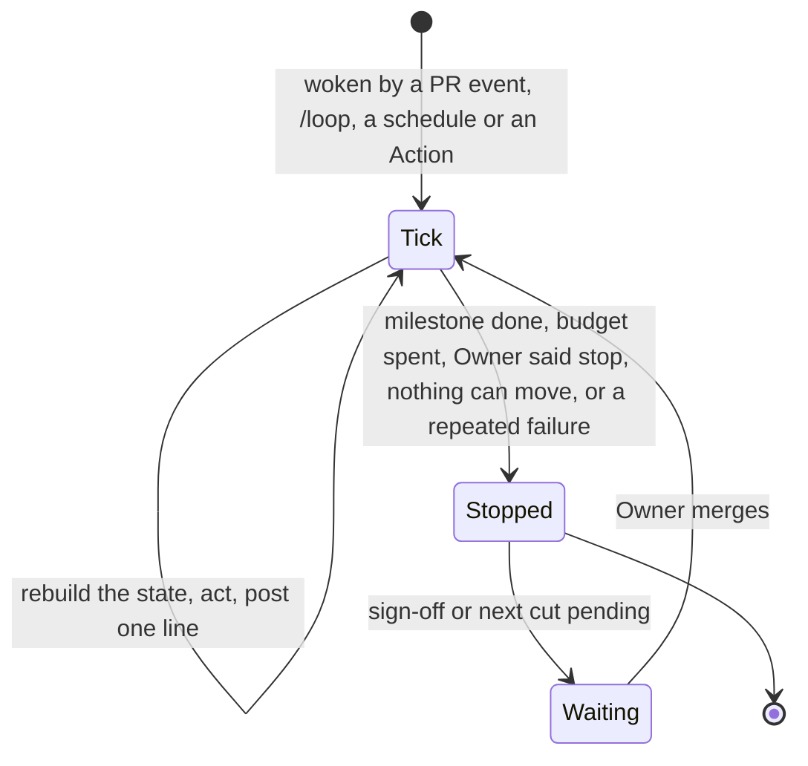

# States: what moves where, and where it is stored

pitaya keeps no state of its own. Every state below lives in the repository or on GitHub, so any fresh session can rebuild it: `/autopilot` does that on every tick, and `/help` does it to say what comes next. If a state isn't in one of the places in [Where state lives](#where-state-lives), it doesn't exist.

## Ticket

A ticket is blocked, not claimable, while any ticket in its "Depends on" isn't done. Its PR targets the milestone's branch at every level; only a ticket that names no milestone targets `main`.

## Milestone

At every level, an active milestone has its branch `milestone/M<n>` (D44): tickets merge into it, and only the milestone PR merges into `main`. What changes with the level is who merges the tickets: the Owner below Level 3, agents from Level 3. At Level 4 the Chief approves the cut inside the milestone branch, and the Owner reviews it at the sign-off.

## PR verdict

A verdict is a comment that starts with the verdict heading and names the full head commit and the verifier's session, or a review from a separate verifier account. A FAIL is one-way: any FAIL on the head is final for that head, and it still counts when its comment is edited or deleted afterwards, because the `agent-merge` workflow records each FAIL it sees in a `verdict-fail` status on the commit. An edited PASS doesn't count, and neither does a PASS from a session the pull request names as a builder. At Level 3 a PASS carries over a merge of the base and nothing else, unless the ticket is `Risk: high`. Plan and milestone PRs never get a passing verdict: the Owner merges them.

## Autopilot run

## Where state lives

| State | Stored in | Changed by |
| --- | --- | --- |
| Ticket open or done | its `Status:` line on `milestone/M<n>` (on `main` for a ticket outside any milestone); or whether its issue is closed | plan PR (open); the ticket's own PR (done) |
| Ticket claimed | a remote branch `ticket/<id>-<slug>`, or an open PR from one | builder or `/autopilot` |
| In review, fixing | the PR's state, its CI and its head commit | builder (pushes), CI |
| Verdict | a verdict comment or review on the PR, for one head commit; with agent-merge, also the `verdict` and `verdict-fail` statuses on that commit | verifier; the `agent-merge` workflow |
| Fix rounds used | the number of FAIL verdicts on the PR; with agent-merge, a FAIL whose comment was deleted still shows as the `verdict-fail` status on its commit | verifier; the `agent-merge` workflow |
| Escalated | an open `needs-owner` issue linked from the PR or ticket | any role (`ask-owner`); the Owner closes it |
| Milestone phase | `Status:` in `docs/milestones/M<n>.md`, plus the `milestone/M<n>` branch and its PR | plan PR; the first `/build` or `/autopilot` tick creates a missing branch; the Owner's merge closes it |
| Milestone behind `main` | `main` isn't an ancestor of `milestone/M<n>` (a `plan/<slug>` PR merged since); an open PR from `sync/<slug>` brings it in | whoever starts the next ticket, or `/autopilot`, opens the sync PR; it merges like a ticket PR |
| Autopilot progress, stop requests | the tracking issue `Autopilot: M<n>` | `/autopilot`; the Owner comments "stop" (only the Owner's own comment counts: [escalation](escalation.md#who-can-answer)) |
| Decisions | `docs/decisions.md`, `docs/adr/` | Owner, Chief |
| Handover of stopped work | `docs/handoff/<branch>.md` | `/handoff` |

## Who may move what

- The **Owner** alone moves a milestone to `done` (merging into `main`), approves the roadmap, answers escalations and, below Level 4, approves each cut.
- The **Chief** moves tickets from open to claimed, starts builders and verifiers, and, at Level 3, merges a PR whose head has a PASS and green checks.
- A **Builder** moves its own ticket from claimed to in review and back, and marks it done in its PR.
- A **Verifier** moves a head from pending to pass or fail, and nothing else.
